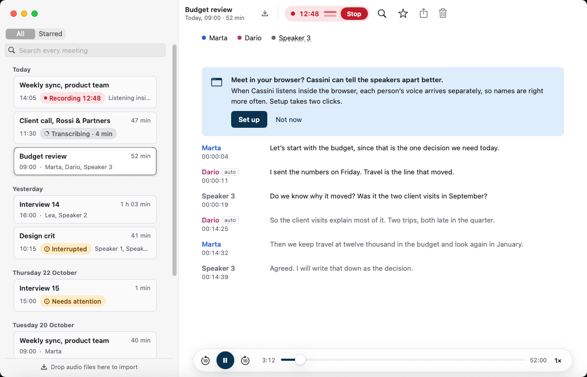
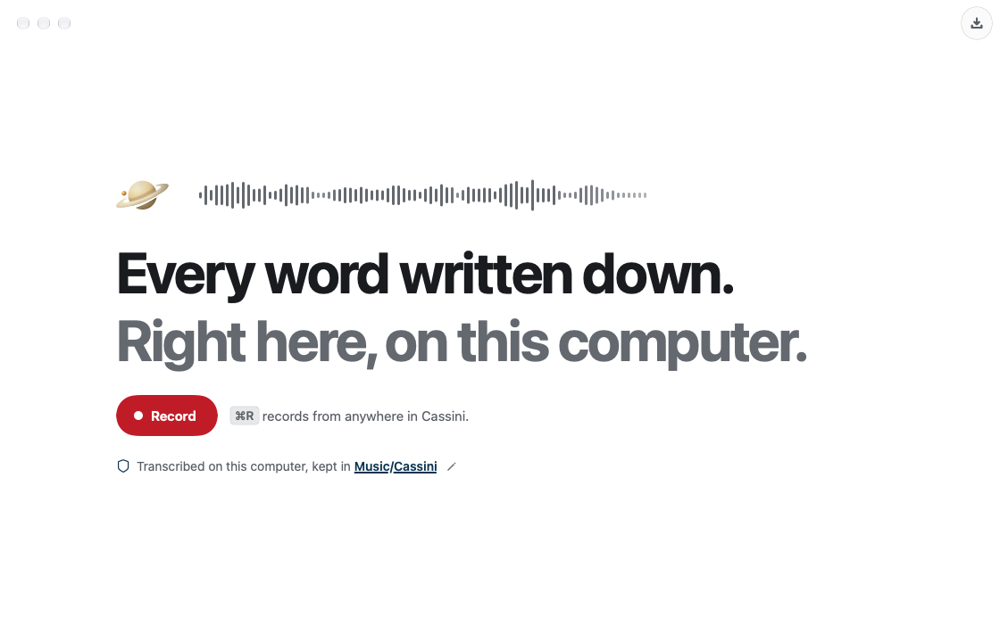
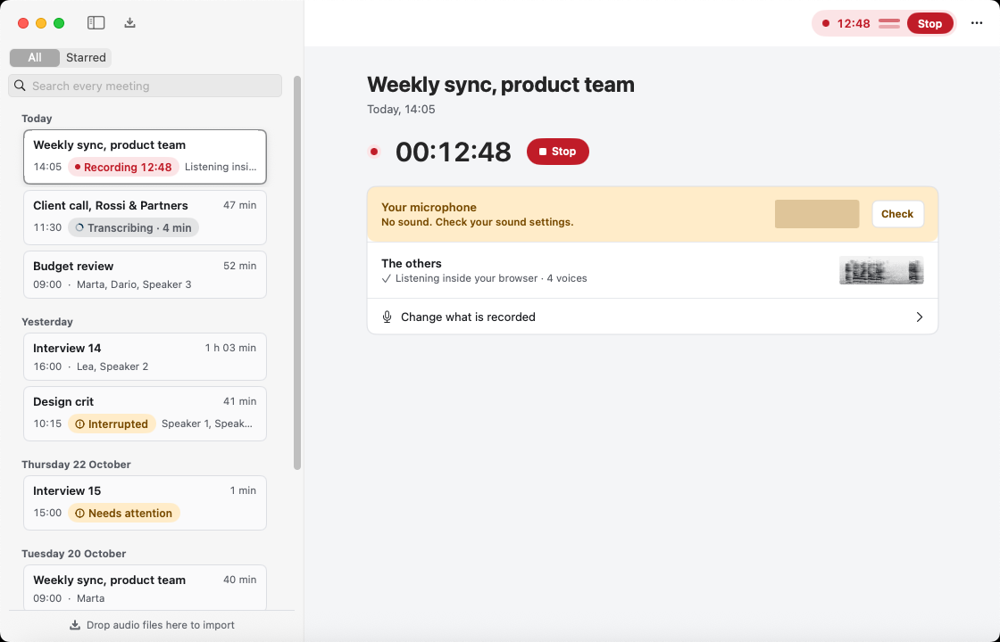
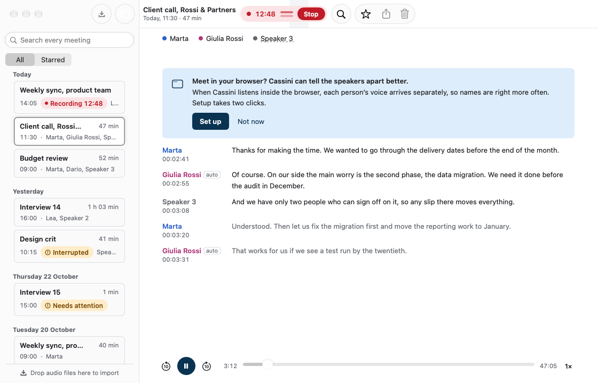
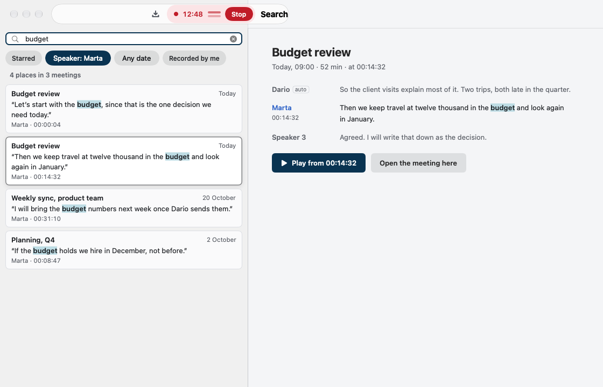
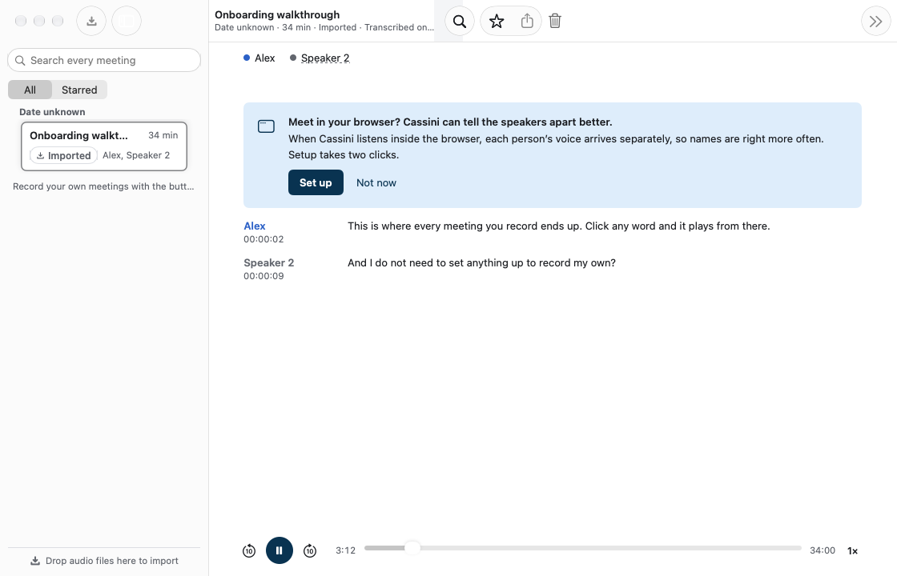
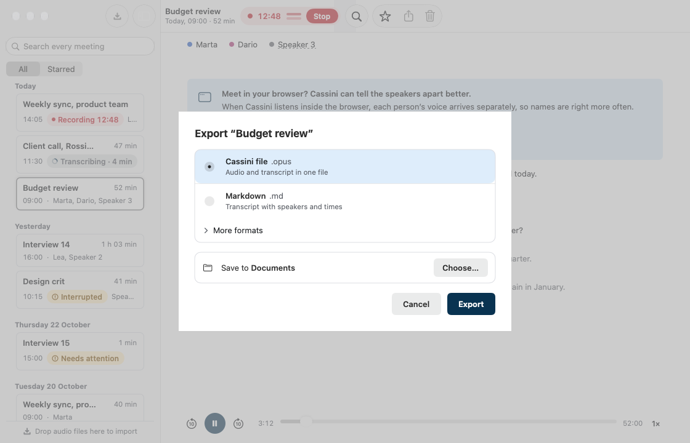

# Cassini talk

Cassini talk is a Mac app that records your meetings, transcribes them offline on your computer, and lets you read, search, and export them.

Developed by Codemyriad and contributors.

*The Library with sample meetings alongside an open meeting transcript.*

## What you can do

- Record a meeting with your microphone and your Mac's sound (the others) straight into your Library, while taking time-pinned notes and watching live sound levels.
- Transcribe meetings automatically on this computer, offline, while you record or after you stop, using the bundled Whistle model or the optional downloadable Parakeet Ultra model in Settings.
- Read a meeting's transcript beside your Library while listening back, with words highlighted as they play, any word clickable to seek, and independent speaker listening.
- Name speakers, merge duplicate speakers (with Undo), and manage Saved voices in Settings.
- Search every meeting in your Library for a phrase, narrow matches by speaker, date, starred meetings, or meetings recorded by you, and jump straight to that moment.
- Import existing audio files (including Cassini `.opus`, FLAC, WAV, M4A, MP3, or zip archives) via **Import Audio…**, **File → Open…**, or drag-and-drop.
- Export one or more meetings as portable Cassini `.opus` files or Markdown transcripts with speakers, timestamps, and notes.
- Record browser meetings in Chrome, Chromium, Microsoft Edge, or Brave using the bundled browser companion, keeping each participant's audio separate.
- Preview any Cassini `.opus` meeting file in Finder by pressing Space for Quick Look.

## Get started

### Install

Cassini talk requires macOS 15 or later and runs on both Apple Silicon and Intel Macs.

1. Download `Cassini-talk-<version>.dmg` from [cassini.talk/download/mac](https://cassini.talk/download/mac/) or the [latest release](https://github.com/codemyriad/cassini-mac/releases/latest). It is signed with Developer ID and notarized by Apple.
2. Open the DMG and drag **Cassini talk** to Applications.

Cassini talk updates itself: choose **Check for Updates…**. Updating leaves your meetings in `Music/Cassini` untouched. To build Cassini from source, follow [`CONTRIBUTING.md`](CONTRIBUTING.md).

### Your first meeting

*The Library before your first meeting.*

Click **Record** in the Library (or press **⌘R** anywhere in Cassini). Cassini records your microphone and your Mac's sound (the others) straight into your Library (`Music/Cassini`, or a custom folder chosen in **Settings → Library**). There is no save dialog.

The first time you record, a **Before your first recording** sheet reminds you that you are responsible for telling the people you record and explains what will be recorded; tick **Don't show again** to hide it next time. macOS then asks for **Microphone** access, followed by **Screen & System Audio Recording** access so Cassini can record the others. You can review both permissions in **System Settings → Privacy & Security**.

*The Recording page during a meeting, showing live sound feedback and source controls.*

The Recording page shows a large timer, live sound and spectrogram feedback for your microphone and the others, an editable **Title**, **Change what is recorded** controls (choose **Me**, **The others**, or **Both**), and time-pinned **Notes**. If your microphone is silent, a warning appears with a **Check** button that opens Sound settings.

Recording keeps going if you switch to another meeting in your Library. If you close the window, Cassini asks whether to **Stop and keep it** or **Keep recording** in the background. Your Mac does not go to sleep while recording. While a recording is running, a timer in the menu bar offers **Stop Recording**, **Add a Note…**, and **Open Cassini**. You can also press **⌥⌘R** (Option-Command-R) to start or stop recording from any app.

Click **Stop** in the Library header, on the Recording page, or in the menu-bar timer when the meeting finishes. If you quit Cassini while recording, it asks first and saves the meeting before closing. If disk space runs low, Cassini warns you; if it gets too low, it stops recording and keeps everything recorded so far.

### Read, listen, and search your meetings

*A meeting open beside the Library with inline speakers and playback controls.*

Cassini transcribes meetings automatically on this Mac, offline, using the included Whistle speech model (or Parakeet Ultra once downloaded in **Settings → Transcription**) on both Apple Silicon and Intel Macs. You can stop transcription without losing audio or partial words, and resume whenever you are ready. If you quit Cassini mid-transcription, it picks up where it left off next time.

In a meeting recorded from your microphone and your Mac's sound, words are attributed to **Me** and **The others**. In browser recordings, each person in the call is kept apart as **Speaker 1**, **Speaker 2**, and so on. You can name speakers, merge duplicate speakers (with **Undo merge** in More actions), and listen to one speaker at a time.

In the Library, meetings are grouped by when they were recorded, with **All** and **Starred** views, status pills, speakers, and inline playback. Click any word to play from that moment, use the floating player bar to skip 10 seconds back or forward, press **Space** to play and pause, or change playback speed with **1×**. Press **⌘F** inside a meeting to find words in that transcript, or use the pinned sidebar search field to search across your entire Library. In Finder, press **Space** on any Cassini `.opus` file to preview it with Quick Look.

*Searching across every meeting with speaker, date, and starred filters.*

Use the search bar pinned at the top of the Library to **Search every meeting** for a phrase. Narrow results by **Starred**, by speaker, by date, or with **Recorded by me**. Each match shows surrounding context; click **Play from** to listen from that moment or **Open the meeting here** to jump straight into the meeting. The search index is private, kept in Cassini's cache folder, and never written into your Library.

### Import meetings and audio

*An imported meeting in the Library marked with the `Imported` badge.*

Click **Import Audio…**, use **File → Open…** (**⌘O**), choose **Open With → Cassini** in Finder, or drop one or more audio files (or a zip archive) onto Cassini to copy them into your Library as **Imported** meetings. The original files are left untouched, and opening the same Cassini `.opus` file a second time opens the existing copy instead of creating a duplicate.

### Export meetings

*The Export sheet over a sample meeting.*

Click the **Export** button in the meeting toolbar (or press **⇧⌘E**), or select multiple meetings in the Library to export them together:

- **Cassini file (`.opus`)** — audio with the transcript, speakers, and notes inside, playable in any Opus-capable player.
- **Markdown (`.md`)** — the transcript as text with speakers, timestamps, and notes.

Cassini saves to **Documents** unless you click **Choose…** to pick another folder, and never overwrites an existing file. Export is the only way a meeting leaves this computer. Voiceprints are never exported.

### Record meetings in your browser

If your meeting runs in Chrome, Chromium, Microsoft Edge, or Brave, open **Settings → Browser companion**, click **Add from Cassini**, and follow the three guided steps. Cassini supplies the companion locally per user (`~/Library/Application Support/...`) — no store account, Xcode, Python, or developer tools are needed.

Once connected, each active browser meeting records into its own Library entry with participants kept apart. You can also enable automatic browser call recording in **Settings → Recording**.

If you are working from a git checkout, you can register the development host with `scripts/install-browser-host.sh YOUR_EXTENSION_ID` (and remove it with `scripts/install-browser-host.sh --uninstall`). See [`Distribution/README.txt`](Distribution/README.txt) and [`docs/browser-recording-protocol.md`](docs/browser-recording-protocol.md) for details.

## Your meetings stay on this computer

Your Library lives in `Music/Cassini` inside your home folder (`~/Music/Cassini`), or another folder you choose in **Settings → Library**, with one folder per meeting.

Nothing is uploaded anywhere. Cassini has no account, no sign-in, and no cloud service. Recording, transcription, and search all happen on this Mac, offline. Export is the only way a meeting leaves this computer, and only when you choose. Portable meetings are ordinary `.opus` audio files carrying their transcript, speakers, and notes, playable in any Opus-capable player.

## Help and feedback

If something does not work or you have a question, open an issue on [GitHub Issues](https://github.com/codemyriad/cassini-mac/issues). Please mention your macOS version and what you were doing when the problem happened.

## For developers

Instructions for building from source, running the test and conformance suites, syncing shared UX contracts, working with the browser protocol, and packaging releases are in [`CONTRIBUTING.md`](CONTRIBUTING.md). Agent workflow guidance is in [`AGENTS.md`](AGENTS.md), and architecture and operations notes are indexed in [`docs/README.md`](docs/README.md).

## License

Cassini for Mac is free software: you can redistribute it and/or modify it under the terms of the
[GNU General Public License, version 3 or later](COPYING).

Cassini bundles the Whistle speech model and the Needle 3.3.0 inference engine by Cactus Compute under the Apache License, Version 2.0; see [`Whistle/LICENSE`](Whistle/LICENSE) and [`Whistle/NOTICE`](Whistle/NOTICE). The format conformance test vectors in `Tests/CassiniKitTests/Conformance` are dedicated to the public domain under CC0.
