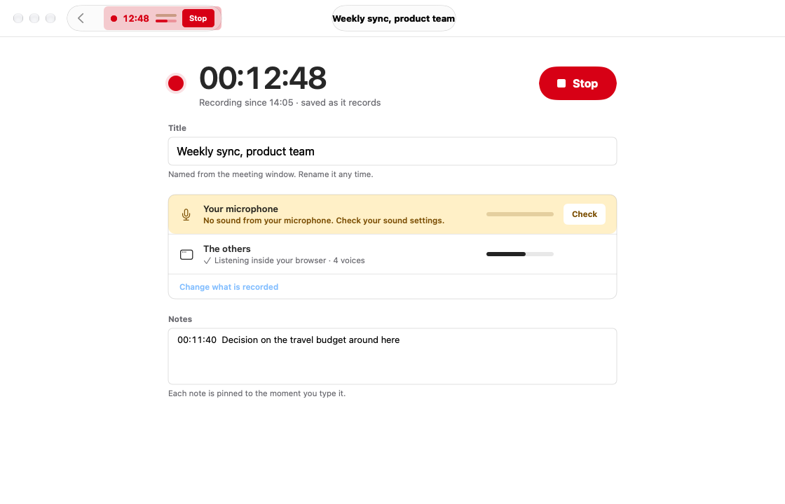
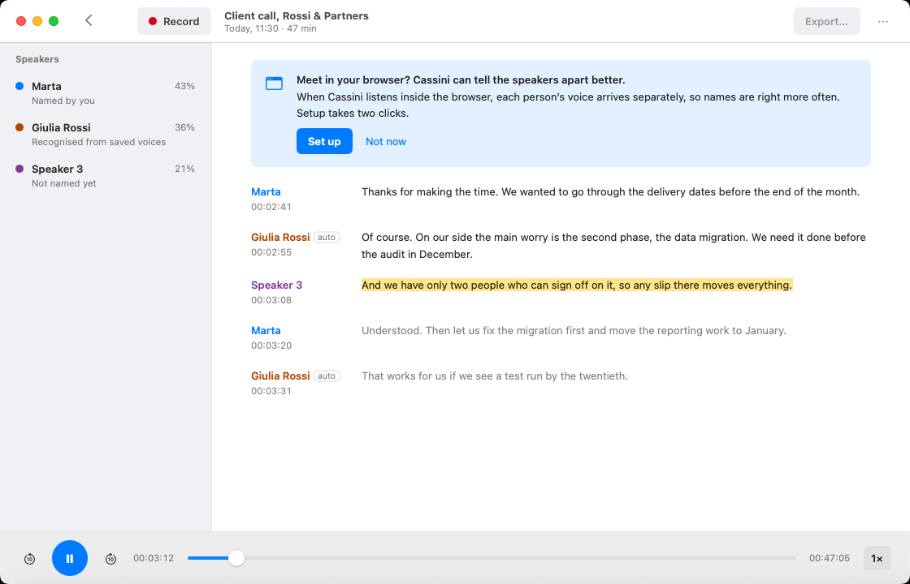
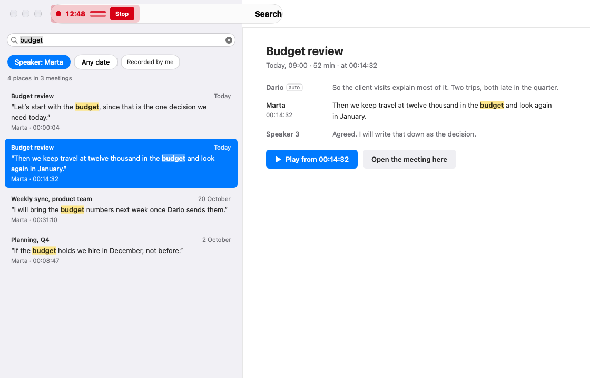
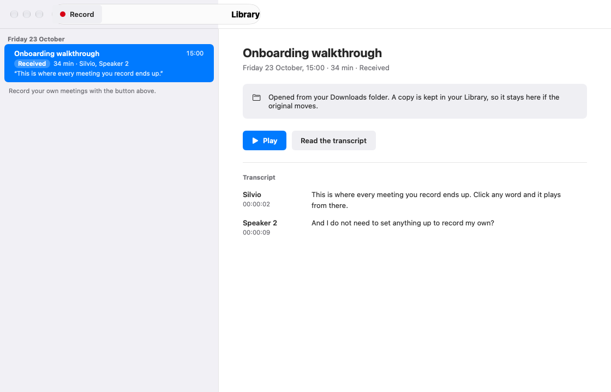
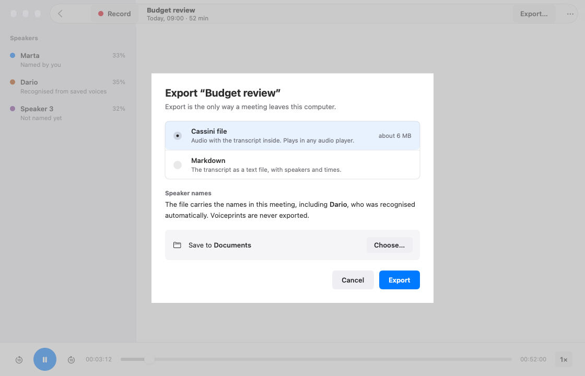

# Cassini

Cassini is a Mac app that records your meetings, writes them down, and lets you read and search them on this computer.


*The Library with sample meetings. The small `auto` tag next to a name comes from the sample data: recognising saved voices is not available yet.*

## What you can do

- Record a meeting with your microphone and all of this Mac's sound (the others) together, straight into your Library, while taking time-pinned notes.
- Let Cassini write your meeting down automatically on this computer, offline, using the speech model included in the app.
- Read a meeting's transcript while listening back, with words highlighted as they are played and any word clickable to play from that moment.
- Search every meeting in your Library for a phrase, narrow matches by speaker, date, or meetings recorded by you, and jump straight to that moment.
- Open Cassini `.opus` files you receive from others so a copy stays in your Library as a Received meeting.
- Export any meeting to share or archive as a portable Cassini `.opus` audio file or as a Markdown transcript with notes.
- Record meetings in Chrome, Chromium, Microsoft Edge, or Brave using the bundled browser extension, keeping each person in the call apart.
- Preview any Cassini `.opus` meeting file in Finder by pressing Space for Quick Look.

## Get started

### Install

The latest published release, `v0.1.0`, is an earlier version: the Library, Recording page, writing down, Search every meeting, Received meetings, and Export described here come with the next release. Until then, you can build Cassini from source by following [`CONTRIBUTING.md`](CONTRIBUTING.md).

Cassini requires macOS 15 or later and runs on both Apple Silicon and Intel Macs.

1. Download `Cassini-<version>.zip` from the [Releases page](https://github.com/codemyriad/cassini-mac/releases) (or bookmark the [latest release](https://github.com/codemyriad/cassini-mac/releases/latest)) and unzip it. While this repository is private, downloading requires a GitHub account with access to it.
2. Move `Cassini.app` to `/Applications`. If you also want to record meetings in your browser, keep the unzipped `Cassini` folder (`BrowserExtension` and `Install Browser Host.command`) in a permanent folder on your Mac.
3. These early builds are ad-hoc signed and not notarized yet, so macOS 15 blocks the first launch. The old right-click → Open shortcut no longer works on macOS 15; open the app like this the first time:
   1. Double-click `Cassini.app`. macOS shows a dialog titled **“Cassini” Not Opened** saying Apple could not verify it is free of malware. Click **Done**, not Move to Trash.
   2. Right away, open **System Settings → Privacy & Security**, scroll to the **Security** section, and click **Open Anyway** next to the Cassini notice. If the notice has disappeared, double-click `Cassini.app` again and look again.
   3. Confirm the prompt with your administrator password or Touch ID. On company-managed Macs the button may be hidden by policy, so ask IT to allow the app.

Do this only for a build you downloaded from this repository. See [Apple’s instructions](https://support.apple.com/102445) for more detail.

To update later, quit Cassini, download and unzip the newer release, replace `Cassini.app` in `/Applications`, and repeat the **Open Anyway** step once for the new build. Updating leaves your meetings in `Music/Cassini` untouched.

### Your first meeting


*The Library before your first meeting.*

Click **Record** in the Library (or press **⌘R** anywhere in Cassini). Cassini records your microphone and all of this Mac's sound (the others) together, straight into your Library (`Music/Cassini`). There is no folder to choose and no save dialog.

The first time you record, a **Before your first recording** sheet reminds you that you are responsible for telling the people you record, and explains what will be recorded; tick **Don't show again** to hide it next time. macOS then asks for **Microphone** access, followed by **Screen & System Audio Recording** access so Cassini can record the others. You can review both permissions in **System Settings → Privacy & Security**.



*The Recording page with a sample meeting. "Change what is recorded" is shown disabled and is not available yet.*

The Recording page shows a large timer, live sound levels for your microphone and the others, an editable **Title**, and **Notes** where each note line is pinned to the moment you start typing it. If your microphone has been silent for 20 seconds, a warning appears with a **Check** button that opens your Sound settings.

Recording keeps going if you go back to the Library. If you close the window, Cassini asks whether to **Stop and keep it** or **Keep recording** in the background. Your Mac does not go to sleep while recording. While a recording is running, a timer in the menu bar offers **Stop Recording**, **Add a Note…**, and **Open Cassini**. You can also press **⌥⌘R** (Option-Command-R) to start or stop recording from any app.

Click **Stop** in the Library header, on the Recording page, or in the menu-bar timer when the meeting finishes. The Library shows the meeting saving and then being written down. If you quit Cassini while recording, it asks first and saves the meeting before it closes. If disk space runs low, Cassini warns you; if it gets too low, it stops recording and keeps everything recorded so far.

### Read and search your meetings



*A meeting page with a sample meeting. Speaker labels such as "Named by you", "Recognised from saved voices", and the small `auto` tag come from the sample data and are not features yet.*

When a recording stops, Cassini writes it down automatically on this Mac, offline, using the included Whistle speech model, on both Apple silicon and Intel Macs. The Library shows progress and an estimate of the time left. If you quit Cassini, it picks up where it left off next time; if writing down fails, click **Try again**. Received meetings without a transcript have a **Write it down** button.

In a meeting recorded from your microphone and your Mac's sound, words are attributed to **Me** and **The others**. In browser recordings, each person in the call is kept apart as **Speaker 1**, **Speaker 2**, and so on.

In the Library, meetings are grouped by day with a quote, the speakers, and a short transcript preview. You can start playback straight from the preview, or open the meeting to see each speaker's share of the conversation and read the full transcript. As the meeting plays, words are highlighted. Click any word to play from that moment, use the player bar to skip 10 seconds back or forward, or press **Space** to play and pause. The **1×** button changes the playback speed, and **⌘[** takes you back to the Library. In Finder, you can also press **Space** on a Cassini `.opus` file to preview it with Quick Look.



*Search every meeting with sample meetings. Filtering by speaker uses speaker names already stored in a meeting; naming speakers and the `auto` tag shown in the sample are not features yet.*

Press **⌘F** or use the search bar in the Library to **Search every meeting** for a phrase. You can narrow results by speaker (when a meeting has named speakers), by date (**Today**, **Past 7 days**, or **Past 30 days**), and with **Recorded by me**. Each hit shows the words around it; click **Play from** to listen from that moment, or **Open the meeting here** to open the meeting at that point. Filters reset when you close Search. The search index is private, kept in Cassini's cache folder, and never written into your Library.

### Open meetings you receive



*A sample meeting in the Library marked as `Received`.*

Use **File → Open…** (**⌘O**), choose **Open With → Cassini** in Finder, or drop a Cassini `.opus` file onto Cassini to copy it into your Library as a **Received** meeting. The original file is left untouched, and the copy stays in your Library even if the original moves. Opening the same file a second time opens the existing copy instead of creating a duplicate.

### Export a meeting



*The Export sheet over a sample meeting. The note about recognised speakers comes from sample data; recognising voices is not a feature yet.*

Click **Export…** in the meeting header (or press **⇧⌘E**) to export a meeting. You have two choices:

- **Cassini file** — audio with the transcript, speakers, and notes inside, which plays in any audio player.
- **Markdown** — the transcript as text with speakers and times, plus your notes.

Cassini saves the file to **Documents** unless you click **Choose…** to pick another folder, and it never overwrites an existing file. Export is the only way a meeting leaves this computer. Voiceprints are never exported.

### Record meetings in your browser

If your meeting runs in Chrome, Chromium, Microsoft Edge, or Brave, you can use the browser companion included in the release zip. It is set up per user for your own browser profiles (`~/Library/Application Support/...`), never system-wide, and does not need Xcode, Python, or developer tools. A meeting page in Cassini may also show a **Set up** suggestion, which displays these setup instructions.

1. Make sure you have opened your browser at least once, and keep the unzipped `BrowserExtension` folder in a permanent place on your Mac.
2. Open `chrome://extensions` in your browser, turn on **Developer mode**, click **Load unpacked**, and select the `BrowserExtension` folder. Copy the 32-letter extension ID shown on the card.
3. Double-click `Install Browser Host.command` in the unzipped release folder, paste the 32-letter extension ID, and press Return. (If you moved `Cassini.app` somewhere other than `/Applications` or the release folder, rerun the installer after putting `Cassini.app` in `/Applications`.)
4. Reload your meeting tab, click the **Cassini Recorder** extension in your browser toolbar, and start recording either with your microphone and the others kept separate, or by capturing what the whole tab plays. In browser recordings, each person in the call is kept apart as Speaker 1, Speaker 2, and so on.
5. Click **Stop and save** when the meeting finishes. The meeting appears in your Library in `Music/Cassini` and is written down automatically.

To remove the browser companion registration later while keeping your meetings:

```sh
"/path/to/Install Browser Host.command" --uninstall
```

If you are working from a git checkout instead of a release zip, you can register the companion with `scripts/install-browser-host.sh YOUR_EXTENSION_ID` (and remove it with `scripts/install-browser-host.sh --uninstall`). See [`Distribution/README.txt`](Distribution/README.txt) and [`docs/browser-recording-protocol.md`](docs/browser-recording-protocol.md) for more detail.

## Your meetings stay on this computer

Your Library lives in `Music/Cassini` inside your home folder (`~/Music/Cassini`), with one folder per meeting.

Nothing is uploaded anywhere. Cassini has no account, no sign-in, and no cloud service. Recording, writing down, and search all happen on this Mac, and writing down works offline with the included speech model. Export is the only way a meeting leaves this computer, and only when you choose. Portable meetings are ordinary `.opus` audio files carrying their transcript, speakers, and notes, playable in any Opus-capable player.

## What's coming

- Naming speakers and keeping names for future meetings, plus recognising saved voices automatically.
- Telling apart several people who share one microphone or one sound source.
- Seeing browser meetings in the Cassini window and recording them with one click, or automatically.
- Choosing what is recorded before you start, for example recording your microphone only.

## Help and feedback

If something does not work or you have a question, open an issue on [GitHub Issues](https://github.com/codemyriad/cassini-mac/issues). Please mention your macOS version and what you were doing when the problem happened.

## For developers

Instructions for building from source, running the test and conformance suites, working with the shared browser protocol, and packaging releases are in [`CONTRIBUTING.md`](CONTRIBUTING.md). Design notes and milestone write-ups live in [`docs/`](docs/).

## License

Cassini for Mac is free software: you can redistribute it and/or modify it under the terms of the
[GNU General Public License, version 3 or later](COPYING).

Cassini bundles the Whistle speech model and the Needle 3.3.0 inference engine by Cactus Compute under the Apache License, Version 2.0; see [`Whistle/LICENSE`](Whistle/LICENSE) and [`Whistle/NOTICE`](Whistle/NOTICE). The format conformance test vectors in `Tests/CassiniKitTests/Conformance` are dedicated to the public domain under CC0.
