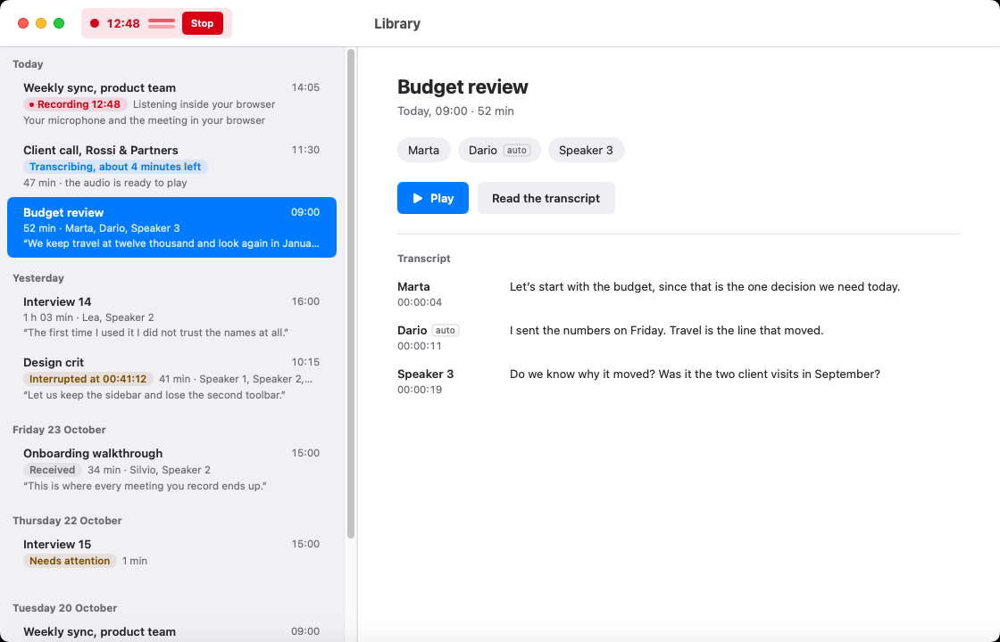
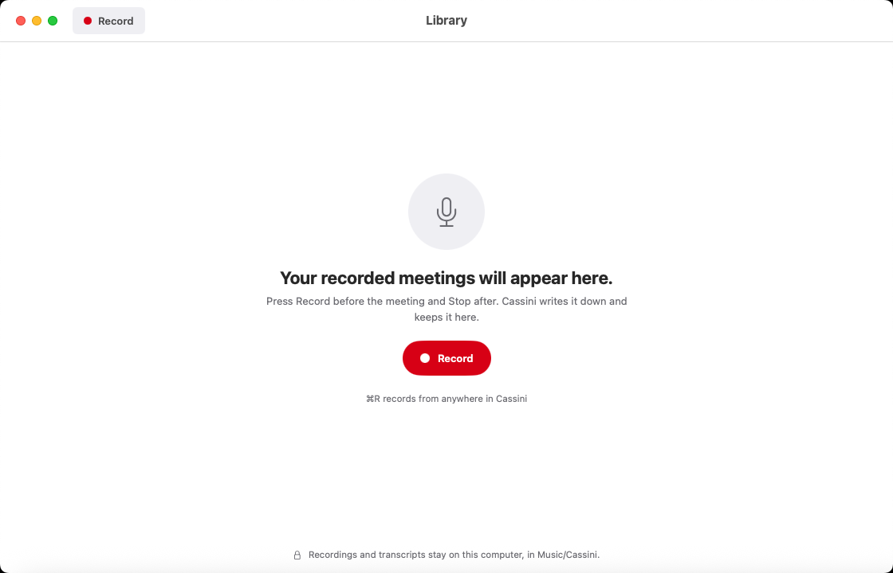

# Cassini

Cassini is a macOS app for recording your work meetings and reading them back on this computer.



*The Library with sample meetings. Some sample rows show states of features that are not finished yet, such as "Transcribing, about 4 minutes left", the small `auto` tag on a recognised voice, and "Needs attention".*

## What you can do

- Browse your meetings in the Library, grouped by day, with speaker names, a quote from the conversation, and the first lines of the transcript.
- Record a meeting on your Mac with your microphone, all system audio, or selected apps, while live level meters show that sound is coming through.
- Record a meeting in Chrome, Chromium, Microsoft Edge, or Brave using the bundled browser extension, either keeping your microphone and the others separate or capturing what the meeting tab plays.
- Play saved meetings directly from the Library with your microphone and the others mixed in time, or open a meeting folder in the Recording window to listen to each audio source on its own.
- Open portable Cassini `.opus` meeting files to read the transcript while words highlight as they are spoken, click any word or timestamp to jump to that moment, filter by speaker, and search inside the transcript.
- Preview portable `.opus` meeting files in Finder with Quick Look, and export an open file’s transcript as Markdown, plain text, SRT, or WebVTT subtitles.

## Get started

### Install

Cassini requires macOS 15 or later and runs on both Apple Silicon and Intel Macs.

1. Download `Cassini-<version>.zip` from the [Releases page](https://github.com/codemyriad/cassini-mac/releases) (or bookmark the [latest release](https://github.com/codemyriad/cassini-mac/releases/latest)) and unzip it. While this repository is private, downloading requires a GitHub account with access to it.
2. Move `Cassini.app` to `/Applications`. If you also want to record meetings in your browser, keep the unzipped `Cassini` folder (`BrowserExtension` and `Install Browser Host.command`) in a permanent folder on your Mac.
3. These early builds are ad-hoc signed and not notarized yet, so macOS 15 blocks the first launch. The old right-click → Open shortcut no longer works on macOS 15; open the app like this the first time:
   1. Double-click `Cassini.app`. macOS shows a dialog titled **“Cassini” Not Opened** saying Apple could not verify it is free of malware. Click **Done**, not Move to Trash.
   2. Right away, open **System Settings → Privacy & Security**, scroll to the **Security** section, and click **Open Anyway** next to the Cassini notice. If the notice has disappeared, double-click `Cassini.app` again and look again.
   3. Confirm the prompt with your administrator password or Touch ID. On company-managed Macs the button may be hidden by policy, so ask IT to allow the app.

Do this only for a build you downloaded from this repository. See [Apple’s instructions](https://support.apple.com/102445) for more detail.

To update later, quit Cassini, download and unzip the newer release, replace `Cassini.app` in `/Applications`, and repeat the **Open Anyway** step once for the new build. Updating leaves your meetings in `Music/Cassini` untouched.

### Your first meeting



*The Library when you first open Cassini. The subtitle on this screen mentions writing the meeting down automatically, which is planned and not active yet.*

1. Click **Record** in the Library (or press **⌘R** from anywhere in Cassini). This opens the Recording window.
2. Enter a title if you want one, choose what sound from the others to include (**All system audio**, **Selected processes**, or **No output audio**), and leave **Record microphone** turned on to include your own voice.
3. Click **Start Recording…** and choose your `Music/Cassini` folder (`~/Music/Cassini`) so the meeting appears in your Library.
4. On your first recording, macOS asks for permission:
   - **Microphone** access when **Record microphone** is on. You can review this in **System Settings → Privacy & Security → Microphone**.
   - **Screen & System Audio Recording** access when you capture system audio or selected apps. You can review this in **System Settings → Privacy & Security → Screen & System Audio Recording**.
5. While you talk, level meters in the Recording window show sound from your microphone and the others. Closing the Recording window keeps recording; press **⌘R** to bring the window back.
6. Click **Stop** (**Stop Recording** in the Recording window) when the meeting ends. Quitting Cassini also stops and saves the meeting.

### Record meetings in your browser

If your meeting runs in Chrome, Chromium, Microsoft Edge, or Brave, you can use the browser companion included in the release zip. It is set up per user for your own browser profiles (`~/Library/Application Support/...`), never system-wide, and does not need Xcode, Python, or developer tools.

1. Make sure you have opened your browser at least once, and keep the unzipped `BrowserExtension` folder in a permanent place on your Mac.
2. Open `chrome://extensions` in your browser, turn on **Developer mode**, click **Load unpacked**, and select the `BrowserExtension` folder. Copy the 32-letter extension ID shown on the card.
3. Double-click `Install Browser Host.command` in the unzipped release folder, paste the 32-letter extension ID, and press Return. (If you moved `Cassini.app` somewhere other than `/Applications` or the release folder, rerun the installer after putting `Cassini.app` in `/Applications`.)
4. Reload your meeting tab, click the **Cassini Recorder** extension in your browser toolbar, and start recording either with your microphone and the others kept separate, or by capturing what the whole tab plays.
5. Click **Stop and save** when the meeting finishes. The meeting is saved in `Music/Cassini` and appears in your Library.

To remove the browser companion registration later while keeping your meetings:

```sh
"/path/to/Install Browser Host.command" --uninstall
```

If you are working from a git checkout instead of a release zip, you can register the companion with `scripts/install-browser-host.sh YOUR_EXTENSION_ID` (and remove it with `scripts/install-browser-host.sh --uninstall`). See [`Distribution/README.txt`](Distribution/README.txt) and [`docs/browser-recording-protocol.md`](docs/browser-recording-protocol.md) for more detail.

## Your meetings stay on this computer

Your meetings live in `Music/Cassini` inside your home folder (`~/Music/Cassini`), with one folder per meeting. When you start a recording from the Recording window, Cassini asks you to pick a folder; choosing `Music/Cassini` keeps everything in one place for the Library.

Nothing is uploaded anywhere. Cassini has no account, no sign-in, and no cloud service. Recording, playback, and file verification all happen on this computer. Portable `.opus` meeting files carry their own transcript and speaker list inside the audio file itself, so you can move or share a file on your own terms and any standard Opus player can still play the audio.

## What's coming

- Writing meetings down on this computer with a bundled speech model, so newly recorded meetings get a transcript without sending audio anywhere.
- Telling speakers apart automatically in recorded meetings so you can see when you and each of the others spoke.
- Naming speakers in a meeting and recognising saved voices across meetings.
- Searching across every meeting in your Library from one search bar.
- Exporting recorded meetings from the Library as portable `.opus` meeting files or transcripts.
- Starting and stopping recordings directly from the Library toolbar with live audio levels.

## Help and feedback

If something does not work or you have a question, open an issue on [GitHub Issues](https://github.com/codemyriad/cassini-mac/issues). Please mention your macOS version and what you were doing when the problem happened.

## For developers

Instructions for building from source, running the test and conformance suites, working with the shared browser protocol, and packaging releases are in [`CONTRIBUTING.md`](CONTRIBUTING.md). Design notes and milestone write-ups live in [`docs/`](docs/).

## License

Copyright © 2026 Code Myriad.

Cassini bundles the Whistle speech model and the Needle 3.3.0 inference engine by Cactus Compute under the Apache License, Version 2.0; see [`Whistle/LICENSE`](Whistle/LICENSE) and [`Whistle/NOTICE`](Whistle/NOTICE). The format conformance test vectors in `Tests/CassiniKitTests/Conformance` are dedicated to the public domain under CC0.
