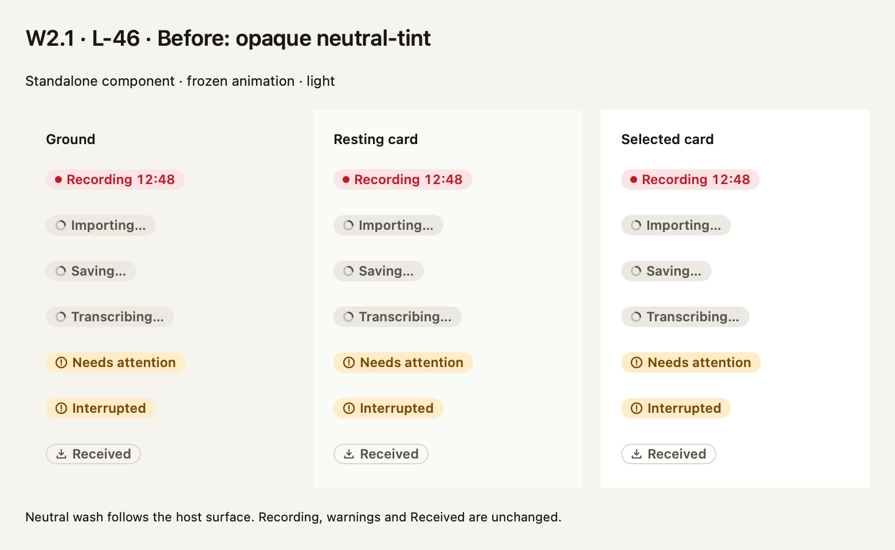
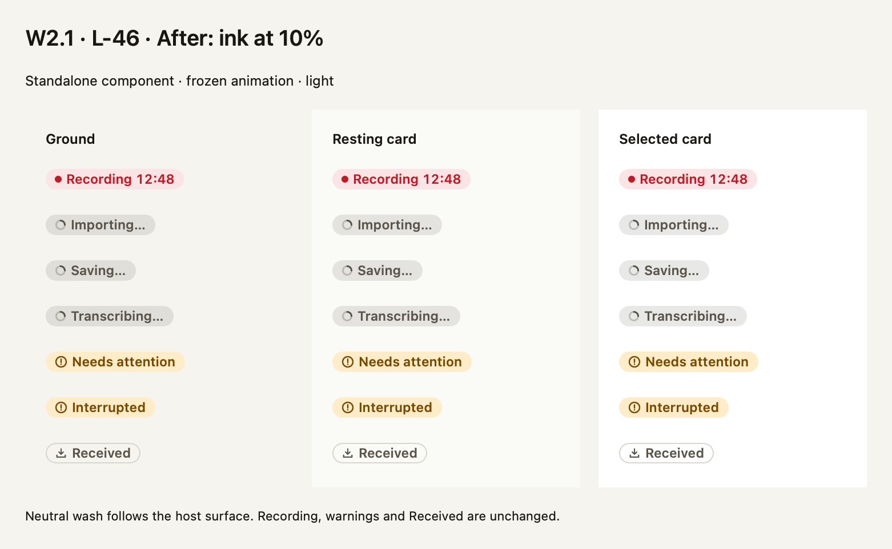
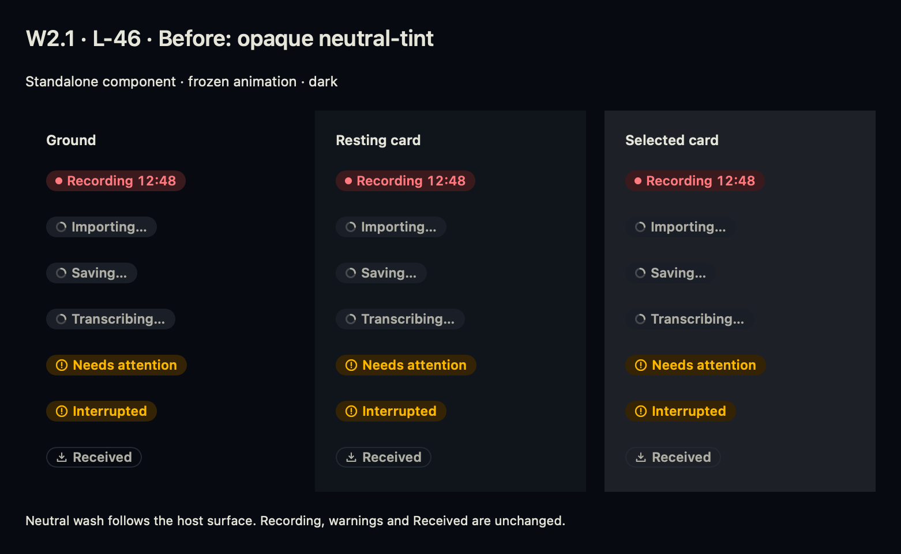
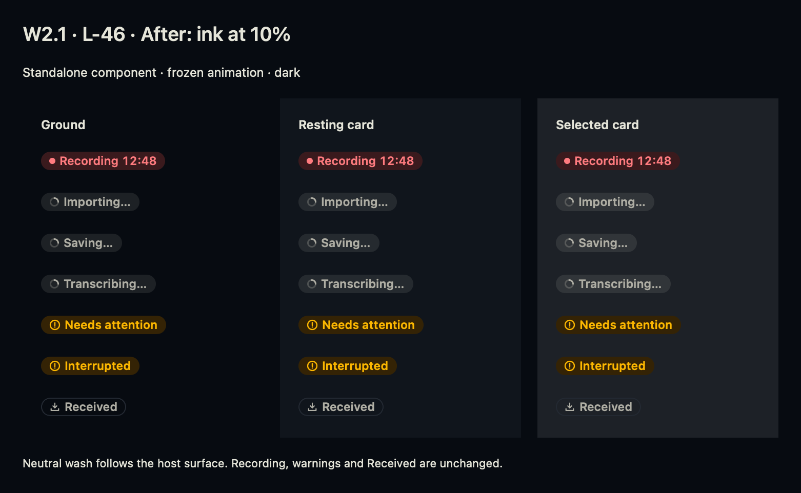

# W2.1 neutral badge wash (L-46)

The decided L-46 rule in the canvas's `lessons/alex-tokens-response-2.md` (“For every app”, item 5) replaces opaque neutral-tint with ink at 10% over the host background. Importing, Saving and Transcribing use that wash; foreground remains opaque. Colours come only from CassiniTokens. Caller labels here are visual fixtures, not catalog changes.

The component remains standalone. agy-mac owns Library/Meeting wiring. No app target, shared contract, token/pin or model changes are included. This uses the existing ink token API and will follow the separate token re-pin without a dependency on that PR.

## Before and after

These are actual SwiftUI ImageRenderer images at 2x with frozen animation, generated without launching the app or opening a window. Before compiles the unmodified standalone component at main `2c21d2c4d78a963500cae2f1a3e638005b26c134` (type names renamed only to coexist); after compiles this checkout's component. Both use this checkout's unchanged generated tokens and MeetingCardPaint for resting/selected card backgrounds.

| Appearance | Before | After |
|---|---|---|
| Light |  |  |
| Dark |  |  |

These prove component treatment, not app integration, dynamic animation or assistive-technology behaviour.

## Checks and replay

`receipt.json` fingerprints both source versions, tokens, card paint, proof and renderer. `checks.json` records 42 native badge × scheme × host cases. Assertions independently check the neutral premultiplied RGBA fill at 10%, opaque foreground, and sRGB compositing over ground, resting card and selected card surfaces. Non-neutral output matches the previous renderer within 1/255 per channel for raster rounding. The existing 14-case badge proof additionally checks glyph symmetry, inherited-foreground independence, height and Received's outline.

Run from the checkout with output outside it, under the shared heavy-run queue:

```sh
~/bin/heavy-run python3 scripts/render-status-badge-wash.py --output /tmp/badge-wash
~/bin/heavy-run python3 evidence/mac/status-badge-neutral-wash/replay.py --output /tmp/badge-wash-mutations
~/bin/heavy-run python3 evidence/mac/status-badge/replay.py --tokens-ref HEAD --output /tmp/badge-glyph-mutations
```

Run mutation scripts sequentially in a disposable worktree: each applies the committed patches to the real component, compiles and renders it, requires a specific native assertion failure (not timeout/compiler failure), and restores exact bytes in `finally`. Four new mutations cover wrong fill token, opaque fill, double opacity, and accidental foreground fading. `mutations.json` records actual failures. The pre-existing four glyph/outline patches are refreshed only for changed context and also pass their mutation replay.

CI runs the 42-case proof and publishes images/receipts in the existing hosted login-session job (or native-sink job for full CI); no additional Mac job. A full checkout preserves the frozen baseline for comparison.
